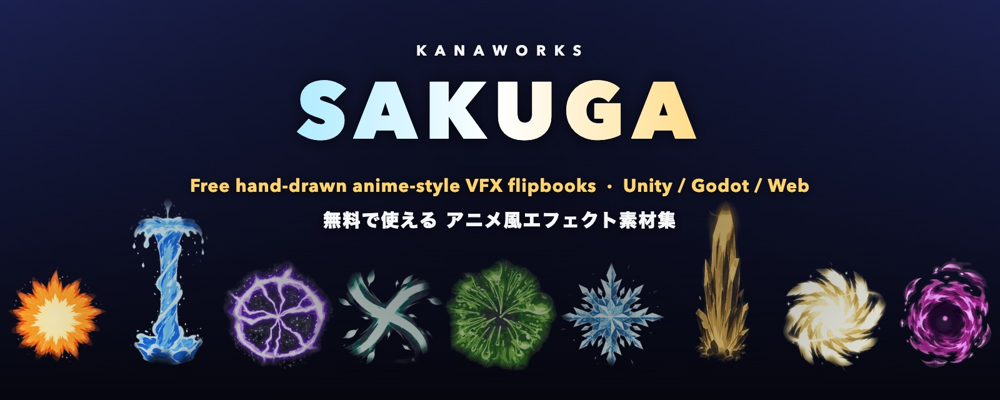
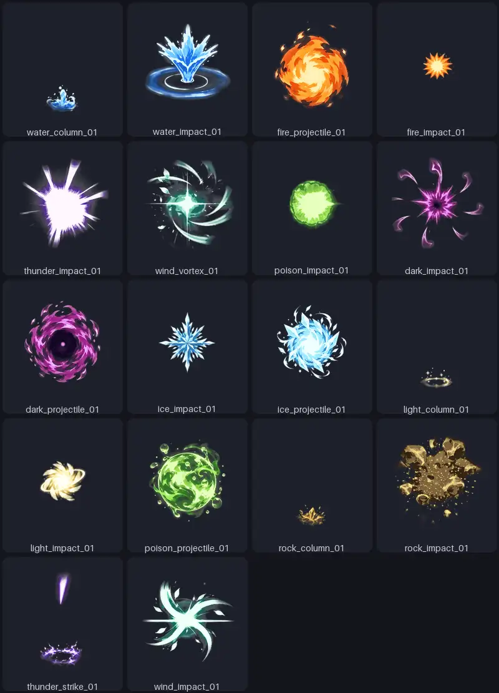
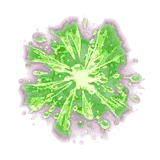

# KanaWorks SAKUGA VFX

<div align="center">

<!-- TODO(banner): docs/assets/banner.jpg 는 다른 세션에서 제작 중. 이 경로를 유지. -->


<p>
  <a href="LICENSE.md"></a>
  <a href="LICENSE.md#mit-license-code"></a>
  
  
  
  <a href="https://github.com/kanaworksai-hue/kanaworks-sakuga-vfx/stargazers"></a>
</p>

<p><a href="https://github.com/kanaworksai-hue"></a>&nbsp;<a href="https://github.com/kanaworksai-hue"><b>A KanaWorks_AI project</b></a></p>

[English](README.md) | [简体中文](README.zh-CN.md) | [日本語](README.ja.md) | 한국어 | [Português (Brasil)](README.pt-BR.md) | [Español](README.es.md)

</div>

**손으로 그린 애니메이션풍(작화) 게임 이펙트를 무료로 제공하는 라이브러리입니다.** 불, 물, 번개, 바람, 독 등의 이펙트를
배경이 투명한 플립북 스프라이트 시트로 제공하며, Unity, Godot, 웹, 그리고 스프라이트 시트를 재생할 수 있는 모든 엔진에서
바로 쓸 수 있습니다.

AI 도구로 이펙트를 만들 수 없거나 이펙트 아티스트를 고용할 예산이 없는 분들을 위해 만들었습니다. 학생, 1인 개발자, 작은
스튜디오, 게임잼, 영상 제작자. 내려받고, 크레딧을 적고, 바로 쓰세요.

- **바로 재생**: 각 이펙트는 스트레이트 알파 PNG 아틀라스(2048px, 프레임마다 투명 여백이 있어 옆 프레임이 번지지 않음)와
  그리드·프레임 수·fps·루프·피벗을 적은 작은 `.flipbook.json`으로 이루어져 있습니다.
- **어떤 엔진이든**: Unity 6 URP 패키지(셰이더, 재생 컴포넌트, 이펙트마다 프리팹을 만드는 임포터, 데모 씬), Godot 4 애드온
  (이펙트별 SpriteFrames, 2D/3D 플레이어, 데모 씬), 약 4KB 웹 플레이어와 PixiJS·Phaser 3·Three.js 예제, 그 밖의 엔진을 위한
  TexturePacker 형식 JSON.
- **변형**: 2048과 1024 시트, 각각 검은 배경의 가산 합성판 포함.
- **무료, 크레딧만 표기**: 연간 총수입 100만 달러 미만의 개인과 기업은 상업적 이용을 포함해 무료. [라이선스](#라이선스) 참고.

<div align="center">

</div>

**미리보기와 다운로드가 있는 갤러리:** https://kanaworksai-hue.github.io/kanaworks-sakuga-vfx/
· **다운로드:** [최신 릴리스](https://github.com/kanaworksai-hue/kanaworks-sakuga-vfx/releases/latest)

## 이펙트 목록

<!-- assets:start -->
| 미리보기 | ID | 속성 | 형태 | 프레임 | 루프 | 추가일 |
|:---:|---|---|---|---:|:---:|---|
|  | [`water_column_01`](assets/water/water_column_01/) | water | column | 56 (8x7) | 아니요 | 2026-10-29 |
|  | [`water_impact_01`](assets/water/water_impact_01/) | water | impact | 64 (8x8) | 아니요 | 2026-10-29 |
|  | [`fire_projectile_01`](assets/fire/fire_projectile_01/) | fire | projectile | 40 (8x5) | 예 | 2026-10-29 |
|  | [`fire_impact_01`](assets/fire/fire_impact_01/) | fire | impact | 64 (8x8) | 아니요 | 2026-10-29 |
|  | [`thunder_impact_01`](assets/thunder/thunder_impact_01/) | thunder | impact | 64 (8x8) | 아니요 | 2026-10-29 |
|  | [`wind_vortex_01`](assets/wind/wind_vortex_01/) | wind | vortex | 64 (8x8) | 아니요 | 2026-10-29 |
|  | [`poison_impact_01`](assets/poison/poison_impact_01/) | poison | impact | 64 (8x8) | 아니요 | 2026-10-29 |
<!-- assets:end -->

형태(form): `projectile`은 날아가는 동안 루프, `impact`는 명중 시 한 번 재생, `column`은 땅에서 솟아오르는 기둥, `vortex`는
제자리에서 소용돌이, `strike`는 위에서 땅으로 내리꽂힘. 이름은 `속성_형태_번호`(`element_form_NN`)입니다.

## 다운로드

각 [릴리스](https://github.com/kanaworksai-hue/kanaworks-sakuga-vfx/releases/latest)에는 다음 파일이 있습니다.

| 파일 | 용도 |
|---|---|
| `kanaworks-sakuga-vfx-<version>-unity.zip` | Unity 6(URP): 프로젝트 폴더에 압축 해제 |
| `kanaworks-sakuga-vfx-<version>-godot.zip` | Godot 4.3+: 프로젝트 폴더에 압축 해제 |
| `kanaworks-sakuga-vfx-<version>-web.zip` | 웹 플레이어, 예제, 갤러리와 모든 시트 |
| `kanaworks-sakuga-vfx-<version>-flipbooks.zip` | 모든 시트의 모든 변형(어떤 엔진이든) |
| `assets/<id>.zip`(갤러리) | 이펙트 하나, 모든 변형 |

이 저장소에서 `assets/<element>/<id>/<id>.png`와 `.flipbook.json`을 바로 가져가도 됩니다.

## 빠른 시작

### Unity 6(URP)

1. `...-unity.zip`을 프로젝트 폴더에 풉니다. `Packages/com.kanaworks.sakuga-vfx/`와 `Assets/KanaWorksSakugaVFX/Flipbooks/`가
   추가됩니다.
2. Unity가 올바른 설정으로 시트를 임포트하고 각 시트 옆에 `<id>.prefab`을 만듭니다.
   **Tools > KanaWorks SAKUGA VFX > Build demo scene**을 실행한 뒤 Play.
3. 코드에서:

```csharp
public SakugaFlipbook fireHit;                                    // fire_impact_01.prefab을 드래그
SakugaFlipbook.Spawn(fireHit, hitPoint, Quaternion.identity);     // 한 번 재생 후 자동 삭제
```

셰이더 `KanaWorks/SakugaFlipbook`: 알파 블렌드 또는 가산, 카메라를 향하거나 직립하는 빌보드(기둥은 뿌리를 땅에 붙인 채 수직
유지), Bloom용 HDR 틴트. 파티클 시스템에서는 `M_<id>_Particles.mat`을 쓰고 Texture Sheet Animation을 시트의 그리드에 맞추세요.

### Godot 4.3+

1. `...-godot.zip`을 프로젝트 폴더에 풉니다(`addons/kanaworks_sakuga_vfx/`와 `sakuga_demo/` 추가).
2. `res://sakuga_demo/demo_2d.tscn` 또는 `demo_3d.tscn`을 열고 F6.
3. 코드에서:

```gdscript
const FIRE_HIT := preload("res://addons/kanaworks_sakuga_vfx/flipbooks/fire/fire_impact_01/fire_impact_01.tres")
SakugaFlipbook2D.spawn(FIRE_HIT, self, hit_position)     # 2D(AnimatedSprite2D), 끝나면 자동 해제
SakugaFlipbook3D.spawn(FIRE_HIT, self, hit_point)        # 3D 빌보드, 같은 .tres
```

`.tres`는 일반 `SpriteFrames`이므로 어떤 `AnimatedSprite2D`에서도 쓸 수 있습니다.

### 웹

```html
<canvas id="fx" width="512" height="512"></canvas>
<script type="module">
  import { load, mount } from './web/sakuga-player.js';
  mount(document.getElementById('fx'), await load('./assets/fire/fire_impact_01/fire_impact_01.flipbook.json'));
</script>
```

`sakuga-player.js`는 의존성 없음(Canvas2D, 약 4KB): `load()`, `Flipbook`(`update(dt)`, `draw(ctx, x, y)`), `mount()`,
PixiJS·Phaser용 `spritesheetData()`. 예제는 [`web/examples/`](web/examples/)(Canvas2D, PixiJS 8, Phaser 3, Three.js.
라이브러리는 버전이 고정된 CDN에서 로드). 폴더를 HTTP로 제공한 뒤(예: `python -m http.server`) `web/`을 여세요.

### 그 밖의 엔진

사이드카를 읽고 그리드를 왼쪽에서 오른쪽, 위에서 아래 순서로 재생합니다.

| 필드 | 의미 |
|---|---|
| `grid` | `[열, 행]` |
| `cell` | 한 프레임의 `[너비, 높이]`(px) |
| `frames` | 재생할 프레임 수(앞에서부터 `frames`칸) |
| `fps`, `loop` | 재생 속도(30)와 루프 여부(projectile) |
| `blend` | `alpha`(스트레이트 알파) 또는 `additive` |
| `pivot` | 칸 안의 `[x, y]`, 왼쪽 위 기준 0~1: 중심 또는 기둥의 뿌리 |
| `bottom_inset` | 기둥 뿌리 아래의 빈 공간(칸 높이 대비 비율) |
| `source` | 옆에 있는 PNG |

릴리스에는 TexturePacker "JSON Hash" 형식(`animations` 포함)의 `<id>.atlas.json`도 들어 있습니다.

## 크레딧

이펙트를 사용하거나 재게시할 때는 보이는 곳에 다음을 표기하세요(게임 크레딧, 영상 설명란, 페이지 푸터 등).

```
VFX: KanaWorks_AI (@KanaWorks_AI)
```

이펙트나 미리보기를 재게시·전재할 때는 크레딧과 https://github.com/kanaworksai-hue/kanaworks-sakuga-vfx 링크를 남겨 주세요.

## 라이선스

이것은 **무료 VFX 라이브러리**이며 오픈 소스 프로젝트가 아닙니다. 이펙트는 조건부로 무료로 쓸 수 있습니다.
요약([라이선스 전문](LICENSE.md)이 적용되며 일본어판이 정본입니다):

- 연간 총수입(직전 회계연도, 관계사 포함)이 **100만 달러 미만**인 개인과 기업은 개인·비영리·상업적 이용 모두 **무료**.
  그 이상이면 [KanaWorks_AI](https://x.com/KanaWorks_AI)에 연락해 별도 라이선스를 받으세요.
- 모든 이용에 **크레딧 표기 필수**: `VFX: KanaWorks_AI (@KanaWorks_AI)`. 재게시 시 크레딧과 저장소 링크 유지.
- **허용**: 자신의 작품 안에서의 수정(색 변경, 타이밍 변경, 자르기, 합성), AI 모델 학습.
- **금지**: 이펙트 자체를 에셋 팩으로 재배포·판매(그대로 또는 가벼운 수정, 에셋 스토어 포함), 직접 만들었다고 주장,
  KanaWorks_AI가 추천하는 것처럼 보이게 하는 것.
- **무보증·지원 없음·면책**: 있는 그대로의 무료 선물입니다.
- 코드(`tools/`, `unity/`, `godot/`, `web/`)는 **MIT**. KanaWorks_AI 이름과 로고는 라이선스 대상이 아닙니다
  ([docs/brand](docs/brand/README.md)).

## 요청

원하는 속성·형태·엔진이 없나요? [에셋 요청](https://github.com/kanaworksai-hue/kanaworks-sakuga-vfx/issues/new?template=asset-request.yml)
이슈를 만들어 주세요: 속성, 형태, 엔진, 용도, 글로 된 설명. 다른 사람 작품의 스크린샷이나 영상은 첨부하지 마세요.

반응이 좋으면 업데이트될 수 있습니다. 일정은 없으며 요청이 반드시 제작된다는 약속도 없습니다.

## 직접 만들기

자신만의 스타일로 이펙트를 만들고 싶다면 자매 프로젝트
[**effekseer-vfx-skill**](https://github.com/kanaworksai-hue/effekseer-vfx-skill)을 써 보세요. 코딩 에이전트가 Effekseer,
Godot, Unity용 실시간 게임 이펙트(이런 플립북 포함)를 만들 수 있게 해 주는 에이전트 스킬입니다.

## 관리자용

도구에는 Python 3.10+와 Pillow, NumPy가 필요합니다(`pip install -r tools/requirements.txt`).

**이펙트 추가**(완성된 배경 투명·스트레이트 알파 PNG 아틀라스, 프레임은 왼쪽→오른쪽, 위→아래):

```sh
python tools/sakuga.py add path/to/sheet.png --id ice_impact_01 --grid 8 8   # 복사, 메타데이터 제거, 카탈로그에 한 줄 추가
python tools/sakuga.py build      # preview.webp, 개요, README 표, dist/ zip과 사이트
python -m pytest -q               # 검증·개인정보·패키지 테스트
```

직접 할 경우: 시트를 `assets/<element>/<id>/<id>.png`에 두고 `catalog.json`에 한 줄 추가
(`{"id": "ice_impact_01", "element": "ice", "form": "impact", "grid": [8, 8], "added": "YYYY-MM-DD", "version": "1.0.0"}`),
`python tools/sakuga.py sync`(cell, frames, `bottom_inset` 측정 후 사이드카 작성)와 `build` 실행.
옵션: `--fps`, `--loop true|false`, `--blend additive`. `python tools/sakuga.py validate`로 전체를 검사합니다.

`python tools/sakuga.py install unity <UnityProject>` / `install godot <GodotProject>`로 패키지와 시트를 프로젝트에 복사해
테스트할 수 있습니다. CI는 푸시마다 테스트를 실행하고, `v*` 태그는 zip을 GitHub 릴리스로, 갤러리를 GitHub Pages로 게시합니다.

<br>

<div align="center">

<a href="https://x.com/KanaWorks_AI"></a>

<p><b>Made with ♥ by <a href="https://x.com/KanaWorks_AI">KanaWorks_AI</a></b> · X: <a href="https://x.com/KanaWorks_AI">@KanaWorks_AI</a></p>

<p><sub>이펙트가 게임에 도움이 되었다면 ⭐ 하나가 다른 사람들이 찾는 데 도움이 됩니다. 다른 프로젝트: <a href="https://github.com/kanaworksai-hue">github.com/kanaworksai-hue</a></sub></p>

<p><sub>Unity, Godot, PixiJS, Phaser, Three.js는 각 소유자의 상표입니다. 이 프로젝트는 독립적인 프로젝트이며 이들과 제휴하거나 승인을 받지 않았습니다.</sub></p>

</div>
