# KanaWorks SAKUGA VFX

<div align="center">

<!-- TODO(banner): docs/assets/banner.jpg está sendo feito em outra sessão. Mantenha este caminho. -->


<p>
  <a href="LICENSE.md"></a>
  <a href="LICENSE.md#mit-license-code"></a>
  
  
  
  <a href="https://github.com/kanaworksai-hue/kanaworks-sakuga-vfx"></a>
</p>

<p><a href="https://github.com/kanaworksai-hue"></a>&nbsp;<a href="https://github.com/kanaworksai-hue"><b>A KanaWorks_AI project</b></a></p>

[English](README.md) | [日本語](README.ja.md) | [简体中文](README.zh-CN.md) | [한국어](README.ko.md) | Português (Brasil) | [Español](README.es.md)

</div>

**Uma biblioteca gratuita de efeitos de jogo de anime (sakuga) em estilo desenhado à mão**: fogo, água, trovão, vento,
veneno e mais, como sprite sheets (flipbooks) com fundo transparente que funcionam no Unity, no Godot, na web ou em
qualquer engine que toque um sprite sheet.

Feita para quem quer efeitos de habilidade bonitos mas não consegue fazê-los com ferramentas de IA ou não tem orçamento
para um artista de VFX: estudantes, devs solo, estúdios pequenos, game jams, criadores de vídeo. Baixe, dê o crédito, use.

- **Pronto para tocar**: cada efeito é um atlas PNG com alpha direto (straight alpha; 2048 px, com margens transparentes
  para que um quadro nunca vaze no outro) mais um pequeno `.flipbook.json` com grade, número de quadros, fps, loop e pivô.
- **Qualquer engine**: pacote Unity 6 URP (shader, componente de reprodução, importador que cria um prefab por efeito,
  cena de demonstração), addon Godot 4 (SpriteFrames por efeito, players 2D e 3D, cenas de demonstração), um player web
  de 4 KB e exemplos para PixiJS, Phaser 3 e Three.js, e JSON no estilo TexturePacker para o resto.
- **Variantes**: folhas de 2048 e 1024, cada uma também em versão aditiva sobre preto.
- **Grátis, com crédito**: grátis para pessoas e empresas com receita anual abaixo de USD 1 milhão, inclusive uso comercial.
  Veja [Licença](#licença).

<div align="center">

</div>

**Galeria com prévia ao vivo e downloads:** https://kanaworksai-hue.github.io/kanaworks-sakuga-vfx/
· **Downloads:** [último release](https://github.com/kanaworksai-hue/kanaworks-sakuga-vfx/releases/latest)

## Efeitos

<!-- assets:start -->
| Prévia | ID | Elemento | Forma | Quadros | Loop | Adicionado |
|:---:|---|---|---|---:|:---:|---|
|  | [`water_column_01`](assets/water/water_column_01/) | water | column | 56 (8x7) | não | 2026-10-29 |
|  | [`water_impact_01`](assets/water/water_impact_01/) | water | impact | 45 (8x8) | não | 2026-10-29 |
|  | [`fire_projectile_01`](assets/fire/fire_projectile_01/) | fire | projectile | 40 (8x5) | sim | 2026-10-29 |
|  | [`fire_impact_01`](assets/fire/fire_impact_01/) | fire | impact | 64 (8x8) | não | 2026-10-29 |
|  | [`thunder_impact_01`](assets/thunder/thunder_impact_01/) | thunder | impact | 64 (8x8) | não | 2026-10-29 |
|  | [`wind_vortex_01`](assets/wind/wind_vortex_01/) | wind | vortex | 64 (8x8) | não | 2026-10-29 |
|  | [`poison_impact_01`](assets/poison/poison_impact_01/) | poison | impact | 64 (8x8) | não | 2026-10-29 |
| 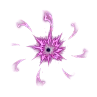 | [`dark_impact_01`](assets/dark/dark_impact_01/) | dark | impact | 64 (8x8) | não | 2026-10-29 |
| 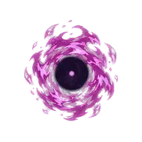 | [`dark_projectile_01`](assets/dark/dark_projectile_01/) | dark | projectile | 40 (8x5) | sim | 2026-10-29 |
| 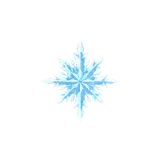 | [`ice_impact_01`](assets/ice/ice_impact_01/) | ice | impact | 64 (8x8) | não | 2026-10-29 |
|  | [`ice_projectile_01`](assets/ice/ice_projectile_01/) | ice | projectile | 40 (8x5) | sim | 2026-10-29 |
|  | [`light_column_01`](assets/light/light_column_01/) | light | column | 56 (8x7) | não | 2026-10-29 |
|  | [`light_impact_01`](assets/light/light_impact_01/) | light | impact | 64 (8x8) | não | 2026-10-29 |
| 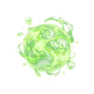 | [`poison_projectile_01`](assets/poison/poison_projectile_01/) | poison | projectile | 40 (8x5) | sim | 2026-10-29 |
|  | [`rock_column_01`](assets/rock/rock_column_01/) | rock | column | 56 (8x7) | não | 2026-10-29 |
| 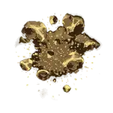 | [`rock_impact_01`](assets/rock/rock_impact_01/) | rock | impact | 64 (8x8) | não | 2026-10-29 |
|  | [`thunder_strike_01`](assets/thunder/thunder_strike_01/) | thunder | strike | 56 (8x7) | não | 2026-10-29 |
|  | [`wind_impact_01`](assets/wind/wind_impact_01/) | wind | impact | 41 (8x8) | não | 2026-10-29 |
| 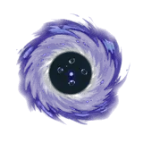 | [`dark_impact_02`](assets/dark/dark_impact_02/) | dark | impact | 64 (8x8) | não | 2026-10-29 |
| 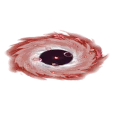 | [`dark_impact_03`](assets/dark/dark_impact_03/) | dark | impact | 64 (8x8) | sim | 2026-10-29 |
| 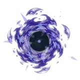 | [`dark_projectile_02`](assets/dark/dark_projectile_02/) | dark | projectile | 40 (8x5) | sim | 2026-10-29 |
| 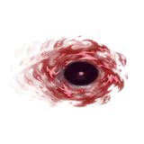 | [`dark_projectile_03`](assets/dark/dark_projectile_03/) | dark | projectile | 40 (8x5) | sim | 2026-10-29 |
|  | [`fire_impact_02`](assets/fire/fire_impact_02/) | fire | impact | 64 (8x8) | não | 2026-10-29 |
|  | [`fire_impact_03`](assets/fire/fire_impact_03/) | fire | impact | 64 (8x8) | não | 2026-10-29 |
| 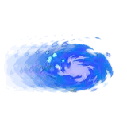 | [`fire_projectile_02`](assets/fire/fire_projectile_02/) | fire | projectile | 40 (8x5) | sim | 2026-10-29 |
| 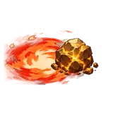 | [`fire_projectile_03`](assets/fire/fire_projectile_03/) | fire | projectile | 40 (8x5) | sim | 2026-10-29 |
| 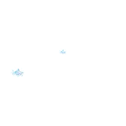 | [`ice_impact_02`](assets/ice/ice_impact_02/) | ice | impact | 64 (8x8) | não | 2026-10-29 |
|  | [`ice_impact_03`](assets/ice/ice_impact_03/) | ice | impact | 64 (8x8) | sim | 2026-10-29 |
|  | [`ice_projectile_02`](assets/ice/ice_projectile_02/) | ice | projectile | 40 (8x5) | sim | 2026-10-29 |
|  | [`ice_projectile_03`](assets/ice/ice_projectile_03/) | ice | projectile | 40 (8x5) | sim | 2026-10-29 |
|  | [`light_column_02`](assets/light/light_column_02/) | light | column | 56 (8x7) | não | 2026-10-29 |
|  | [`light_column_03`](assets/light/light_column_03/) | light | column | 56 (8x7) | não | 2026-10-29 |
|  | [`light_impact_02`](assets/light/light_impact_02/) | light | impact | 64 (8x8) | não | 2026-10-29 |
|  | [`light_impact_03`](assets/light/light_impact_03/) | light | impact | 64 (8x8) | não | 2026-10-29 |
| 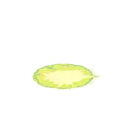 | [`poison_impact_02`](assets/poison/poison_impact_02/) | poison | impact | 64 (8x8) | não | 2026-10-29 |
| 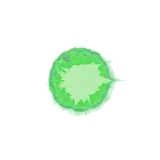 | [`poison_impact_03`](assets/poison/poison_impact_03/) | poison | impact | 64 (8x8) | não | 2026-10-29 |
| 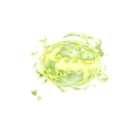 | [`poison_projectile_02`](assets/poison/poison_projectile_02/) | poison | projectile | 40 (8x5) | sim | 2026-10-29 |
| 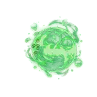 | [`poison_projectile_03`](assets/poison/poison_projectile_03/) | poison | projectile | 40 (8x5) | sim | 2026-10-29 |
|  | [`rock_column_02`](assets/rock/rock_column_02/) | rock | column | 56 (8x7) | não | 2026-10-29 |
|  | [`rock_column_03`](assets/rock/rock_column_03/) | rock | column | 56 (8x7) | não | 2026-10-29 |
| 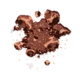 | [`rock_impact_02`](assets/rock/rock_impact_02/) | rock | impact | 64 (8x8) | não | 2026-10-29 |
| 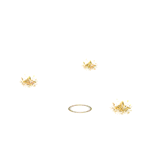 | [`rock_impact_03`](assets/rock/rock_impact_03/) | rock | impact | 64 (8x8) | não | 2026-10-29 |
|  | [`thunder_impact_02`](assets/thunder/thunder_impact_02/) | thunder | impact | 64 (8x8) | não | 2026-10-29 |
| 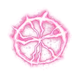 | [`thunder_impact_03`](assets/thunder/thunder_impact_03/) | thunder | impact | 40 (8x5) | sim | 2026-10-29 |
| 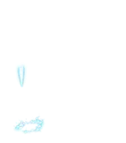 | [`thunder_strike_02`](assets/thunder/thunder_strike_02/) | thunder | strike | 56 (8x7) | não | 2026-10-29 |
| 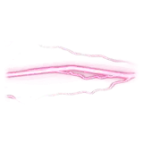 | [`thunder_strike_03`](assets/thunder/thunder_strike_03/) | thunder | strike | 40 (8x5) | sim | 2026-10-29 |
| 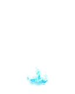 | [`water_column_02`](assets/water/water_column_02/) | water | column | 56 (8x7) | não | 2026-10-29 |
| 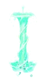 | [`water_column_03`](assets/water/water_column_03/) | water | column | 56 (8x7) | sim | 2026-10-29 |
| 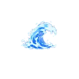 | [`water_impact_02`](assets/water/water_impact_02/) | water | impact | 64 (8x8) | não | 2026-10-29 |
| 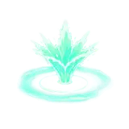 | [`water_impact_03`](assets/water/water_impact_03/) | water | impact | 64 (8x8) | não | 2026-10-29 |
|  | [`wind_impact_02`](assets/wind/wind_impact_02/) | wind | impact | 64 (8x8) | não | 2026-10-29 |
|  | [`wind_impact_03`](assets/wind/wind_impact_03/) | wind | impact | 64 (8x8) | não | 2026-10-29 |
|  | [`wind_vortex_02`](assets/wind/wind_vortex_02/) | wind | vortex | 56 (8x7) | não | 2026-10-29 |
|  | [`wind_vortex_03`](assets/wind/wind_vortex_03/) | wind | vortex | 64 (8x8) | não | 2026-10-29 |
| 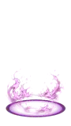 | [`dark_aura_01`](assets/dark/dark_aura_01/) | dark | aura | 40 (8x5) | sim | 2026-10-29 |
| 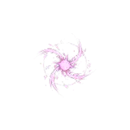 | [`dark_charge_01`](assets/dark/dark_charge_01/) | dark | charge | 64 (8x8) | não | 2026-10-29 |
| 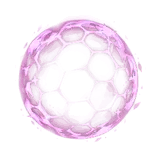 | [`dark_shield_01`](assets/dark/dark_shield_01/) | dark | shield | 40 (8x5) | sim | 2026-10-29 |
| 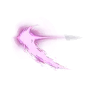 | [`dark_slash_01`](assets/dark/dark_slash_01/) | dark | slash | 64 (8x8) | não | 2026-10-29 |
| 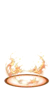 | [`fire_aura_01`](assets/fire/fire_aura_01/) | fire | aura | 40 (8x5) | sim | 2026-10-29 |
|  | [`fire_charge_01`](assets/fire/fire_charge_01/) | fire | charge | 64 (8x8) | não | 2026-10-29 |
| 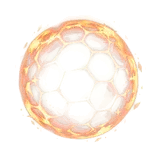 | [`fire_shield_01`](assets/fire/fire_shield_01/) | fire | shield | 40 (8x5) | sim | 2026-10-29 |
|  | [`fire_slash_01`](assets/fire/fire_slash_01/) | fire | slash | 64 (8x8) | não | 2026-10-29 |
| 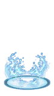 | [`ice_aura_01`](assets/ice/ice_aura_01/) | ice | aura | 40 (8x5) | sim | 2026-10-29 |
| 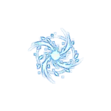 | [`ice_charge_01`](assets/ice/ice_charge_01/) | ice | charge | 64 (8x8) | não | 2026-10-29 |
| 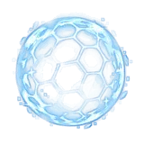 | [`ice_shield_01`](assets/ice/ice_shield_01/) | ice | shield | 40 (8x5) | sim | 2026-10-29 |
| 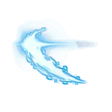 | [`ice_slash_01`](assets/ice/ice_slash_01/) | ice | slash | 64 (8x8) | não | 2026-10-29 |
| 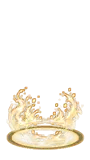 | [`light_aura_01`](assets/light/light_aura_01/) | light | aura | 40 (8x5) | sim | 2026-10-29 |
| 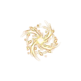 | [`light_charge_01`](assets/light/light_charge_01/) | light | charge | 64 (8x8) | não | 2026-10-29 |
| 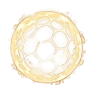 | [`light_shield_01`](assets/light/light_shield_01/) | light | shield | 40 (8x5) | sim | 2026-10-29 |
| 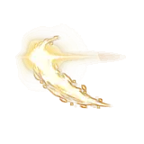 | [`light_slash_01`](assets/light/light_slash_01/) | light | slash | 64 (8x8) | não | 2026-10-29 |
| 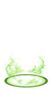 | [`poison_aura_01`](assets/poison/poison_aura_01/) | poison | aura | 40 (8x5) | sim | 2026-10-29 |
|  | [`poison_charge_01`](assets/poison/poison_charge_01/) | poison | charge | 64 (8x8) | não | 2026-10-29 |
|  | [`poison_shield_01`](assets/poison/poison_shield_01/) | poison | shield | 40 (8x5) | sim | 2026-10-29 |
|  | [`poison_slash_01`](assets/poison/poison_slash_01/) | poison | slash | 64 (8x8) | não | 2026-10-29 |
|  | [`rock_aura_01`](assets/rock/rock_aura_01/) | rock | aura | 40 (8x5) | sim | 2026-10-29 |
|  | [`rock_charge_01`](assets/rock/rock_charge_01/) | rock | charge | 64 (8x8) | não | 2026-10-29 |
|  | [`rock_shield_01`](assets/rock/rock_shield_01/) | rock | shield | 40 (8x5) | sim | 2026-10-29 |
|  | [`rock_slash_01`](assets/rock/rock_slash_01/) | rock | slash | 64 (8x8) | não | 2026-10-29 |
|  | [`thunder_aura_01`](assets/thunder/thunder_aura_01/) | thunder | aura | 40 (8x5) | sim | 2026-10-29 |
|  | [`thunder_charge_01`](assets/thunder/thunder_charge_01/) | thunder | charge | 64 (8x8) | não | 2026-10-29 |
|  | [`thunder_shield_01`](assets/thunder/thunder_shield_01/) | thunder | shield | 40 (8x5) | sim | 2026-10-29 |
|  | [`thunder_slash_01`](assets/thunder/thunder_slash_01/) | thunder | slash | 64 (8x8) | não | 2026-10-29 |
|  | [`water_aura_01`](assets/water/water_aura_01/) | water | aura | 40 (8x5) | sim | 2026-10-29 |
|  | [`water_charge_01`](assets/water/water_charge_01/) | water | charge | 64 (8x8) | não | 2026-10-29 |
|  | [`water_shield_01`](assets/water/water_shield_01/) | water | shield | 40 (8x5) | sim | 2026-10-29 |
|  | [`water_slash_01`](assets/water/water_slash_01/) | water | slash | 64 (8x8) | não | 2026-10-29 |
|  | [`wind_aura_01`](assets/wind/wind_aura_01/) | wind | aura | 40 (8x5) | sim | 2026-10-29 |
|  | [`wind_charge_01`](assets/wind/wind_charge_01/) | wind | charge | 64 (8x8) | não | 2026-10-29 |
|  | [`wind_shield_01`](assets/wind/wind_shield_01/) | wind | shield | 40 (8x5) | sim | 2026-10-29 |
|  | [`wind_slash_01`](assets/wind/wind_slash_01/) | wind | slash | 64 (8x8) | não | 2026-10-29 |
<!-- assets:end -->

Formas: `projectile` fica em loop enquanto voa; `impact` toca uma vez no acerto; `column` sobe a partir do chão;
`vortex` gira no lugar; `strike` desce de cima até o chão; `shield` fica em loop em volta de um personagem; `aura` fica em
loop aos pés de um personagem; `charge` é a conjuração (combina com todos os projectiles do mesmo elemento); `slash` é um
golpe corpo a corpo. Os nomes seguem `elemento_forma_NN` (`element_form_NN`): `_01` é o visual clássico, `_02` e `_03` são
variantes de estilo (por exemplo, `fire_projectile_02` fogo de alma e `fire_projectile_03` meteoro). A receita define a
categoria de cada um (uma variante pode ser `area`, `beam` ou `buff`).

## Efeitos em camadas (receitas)

Cada efeito também tem uma **receita** (no `catalog.json` e no seu sidecar) que transforma o desenho em um efeito de
habilidade pronto para usar: categoria e casos de uso, os efeitos com que combina (charge, projétil, impacto), onde fica
(centro ou chão; billboard, em pé, deitado ou girado ao longo do voo), o tamanho em metros, o quadro de contato e as camadas
secundárias: flash de contato, anel de onda de choque, faíscas, detritos, fumaça em cel, decal no chão, uma luz com curva de
intensidade, tremor de câmera, hit stop e som. O pacote Unity gera um `<id>_fx.prefab` a partir dela, o addon Godot um
`SakugaEffect3D`, e o `web/sakuga-fx.js` toca o efeito em um canvas. Texturas brancas, decals e sons compartilhados ficam em
[`assets/_shared/`](assets/_shared/).

```sh
python tools/sakuga.py suggest "ice arrow hitting a slime"
#  17.5  ice_projectile_02  projectile glacier  ice lance, ice arrow, ice shard
#  ...
#  chain: ice_charge_01 -> ice_projectile_02 -> ice_impact_01
```

```csharp
SakugaFX.Cast("ice_projectile_02", hand.position, slime, p => slime.Damage(10));   // Unity: charge, flight, impact
```

Se você usa um agente de código, comece por [AGENTS.md](AGENTS.md) (e [llms.txt](llms.txt)).

## Downloads

Cada [release](https://github.com/kanaworksai-hue/kanaworks-sakuga-vfx/releases/latest) traz:

| Arquivo | Para |
|---|---|
| `kanaworks-sakuga-vfx-<version>-unity.zip` | Unity 6 (URP): descompacte na pasta do projeto |
| `kanaworks-sakuga-vfx-<version>-godot.zip` | Godot 4.3+: descompacte na pasta do projeto |
| `kanaworks-sakuga-vfx-<version>-web.zip` | player web, exemplos e galeria, com todas as folhas |
| `kanaworks-sakuga-vfx-<version>-flipbooks.zip` | todas as folhas em todas as variantes, para qualquer engine |
| `assets/<id>.zip` (na galeria) | um efeito, todas as variantes |

Você também pode pegar um único `assets/<element>/<id>/<id>.png` e o seu `.flipbook.json` direto deste repositório.

## Início rápido

### Unity 6 (URP)

1. Descompacte `...-unity.zip` na pasta do projeto. Ele adiciona `Packages/com.kanaworks.sakuga-vfx/` e
   `Assets/KanaWorksSakugaVFX/Flipbooks/`.
2. O Unity importa as folhas com as configurações certas e cria `<id>.prefab` ao lado de cada uma.
   **Tools > KanaWorks SAKUGA VFX > Build demo scene** e depois Play.
3. No código:

```csharp
public SakugaFlipbook fireHit;                                    // arraste fire_impact_01.prefab aqui
SakugaFlipbook.Spawn(fireHit, hitPoint, Quaternion.identity);     // toca uma vez e se destrói
```

Shader `KanaWorks/SakugaFlipbook`: blend alpha ou aditivo, billboard voltado para a câmera ou em pé (colunas ficam
verticais com a raiz no chão), tint HDR para Bloom. Para um Particle System use `M_<id>_Particles.mat` com o Texture
Sheet Animation ajustado à grade da folha.

### Godot 4.3+

1. Descompacte `...-godot.zip` na pasta do projeto (adiciona `addons/kanaworks_sakuga_vfx/` e `sakuga_demo/`).
2. Abra `res://sakuga_demo/demo_2d.tscn` ou `demo_3d.tscn` e pressione F6.
3. No código:

```gdscript
const FIRE_HIT := preload("res://addons/kanaworks_sakuga_vfx/flipbooks/fire/fire_impact_01/fire_impact_01.tres")
SakugaFlipbook2D.spawn(FIRE_HIT, self, hit_position)     # 2D (AnimatedSprite2D), se libera ao terminar
SakugaFlipbook3D.spawn(FIRE_HIT, self, hit_point)        # billboard 3D, o mesmo .tres
```

Cada `.tres` é um `SpriteFrames` comum, então funciona em qualquer `AnimatedSprite2D`.

### Web

```html
<canvas id="fx" width="512" height="512"></canvas>
<script type="module">
  import { load, mount } from './web/sakuga-player.js';
  mount(document.getElementById('fx'), await load('./assets/fire/fire_impact_01/fire_impact_01.flipbook.json'));
</script>
```

`sakuga-player.js` não tem dependências (Canvas2D, cerca de 4 KB): `load()`, `Flipbook` (`update(dt)`,
`draw(ctx, x, y)`), `mount()` e `spritesheetData()` para PixiJS e Phaser. Exemplos: [`web/examples/`](web/examples/)
(Canvas2D, PixiJS 8, Phaser 3, Three.js; as bibliotecas vêm de um CDN com versões fixas). Sirva a pasta por HTTP (por
exemplo `python -m http.server`) e abra `web/`.

### Qualquer outra engine

Leia o sidecar e toque a grade da esquerda para a direita, de cima para baixo:

| Campo | Significado |
|---|---|
| `grid` | `[colunas, linhas]` |
| `cell` | `[largura, altura]` de um quadro em pixels |
| `frames` | quadros a tocar (as primeiras `frames` células) |
| `fps`, `loop` | velocidade (30) e se repete (projéteis) |
| `blend` | `alpha` (alpha direto) ou `additive` |
| `pivot` | `[x, y]` na célula, 0-1 a partir do canto superior esquerdo: o centro, ou a raiz de uma coluna |
| `bottom_inset` | espaço vazio abaixo da raiz de uma coluna, como fração da altura da célula |
| `source` | o PNG ao lado |

O release também traz `<id>.atlas.json` (TexturePacker "JSON Hash" com a lista `animations`).

## Crédito

Coloque isto onde você usar ou repostar os efeitos (créditos do jogo, descrição do vídeo, rodapé da página):

```
VFX: KanaWorks_AI (@KanaWorks_AI)
```

Ao repostar os efeitos ou suas prévias, mantenha o crédito e um link para
https://github.com/kanaworksai-hue/kanaworks-sakuga-vfx.

## Licença

Esta é uma **biblioteca de VFX gratuita**, não um projeto de código aberto: os efeitos são de uso gratuito com condições.
Resumo (vale a [licença completa](LICENSE.md), e o texto em japonês prevalece):

- **Grátis** para uso pessoal, não comercial e comercial por pessoas e empresas com receita bruta anual (exercício
  anterior, incluindo afiliadas) **abaixo de USD 1.000.000**. Acima disso, fale com
  [KanaWorks_AI](https://x.com/KanaWorks_AI) para uma licença separada.
- **Crédito obrigatório** em todo uso: `VFX: KanaWorks_AI (@KanaWorks_AI)`. Reposts mantêm o crédito e o link do repositório.
- **Permitido**: modificar os efeitos dentro da sua obra (cores, tempo, recorte, composição); treinar modelos de IA.
- **Proibido**: redistribuir ou vender os próprios efeitos como pacote de assets (como estão ou levemente modificados,
  incluindo lojas de assets); dizer que você os fez; sugerir que a KanaWorks_AI endossa você.
- **Sem garantia, sem suporte, sem responsabilidade**: um presente gratuito, no estado em que se encontra.
- O código (`tools/`, `unity/`, `godot/`, `web/`) é **MIT**. O nome e o logo KanaWorks_AI não são licenciados
  ([docs/brand](docs/brand/README.md)).

## Pedidos

Quer um elemento, forma ou engine que não está aqui? Abra um
[pedido de asset](https://github.com/kanaworksai-hue/kanaworks-sakuga-vfx/issues/new?template=asset-request.yml):
elemento, forma, engine, para que serve e uma descrição em palavras. Não anexe capturas ou vídeos de trabalhos de outras pessoas.

A biblioteca pode ser atualizada se as pessoas gostarem. Não há cronograma nem promessa de que um pedido será feito.

## Faça os seus

Quer efeitos no seu próprio estilo? O projeto irmão
[**effekseer-vfx-skill**](https://github.com/kanaworksai-hue/effekseer-vfx-skill) é uma agent skill que permite a um
agente de programação criar VFX de jogo em tempo real para Effekseer, Godot e Unity, incluindo flipbooks como estes.

## Para mantenedores

As ferramentas precisam de Python 3.10+ com Pillow e NumPy (`pip install -r tools/requirements.txt`).

**Adicionar um efeito** (um atlas PNG pronto, transparente, com alpha direto, quadros da esquerda para a direita e de cima para baixo):

```sh
python tools/sakuga.py add path/to/sheet.png --id ice_impact_01 --grid 8 8   # copia, remove metadados, adiciona a linha no catálogo
python tools/sakuga.py build      # preview.webp, visão geral, tabelas dos READMEs, zips em dist/ e site
python -m pytest -q               # testes de validação, privacidade e pacotes
```

Ou à mão: coloque a folha em `assets/<element>/<id>/<id>.png`, adicione uma linha ao `catalog.json`
(`{"id": "ice_impact_01", "element": "ice", "form": "impact", "grid": [8, 8], "added": "YYYY-MM-DD", "version": "1.0.0"}`),
depois rode `python tools/sakuga.py sync` (mede cell, frames e `bottom_inset` e grava o sidecar) e `build`.
Opções: `--fps`, `--loop true|false`, `--blend additive`. `python tools/sakuga.py validate` verifica tudo.

`python tools/sakuga.py install unity <UnityProject>` / `install godot <GodotProject>` copia o pacote e as folhas para
um projeto de teste. O CI roda os testes a cada push; uma tag `v*` publica os zips num release do GitHub e a galeria no GitHub Pages.

```
assets/<element>/<id>/   <id>.png, <id>.flipbook.json, preview.webp
catalog.json             one line per effect
tools/                   validate, sync, add, build, install (MIT)
unity/                   UPM package com.kanaworks.sakuga-vfx (MIT)
godot/                   addon + demo scenes (MIT)
web/                     player, gallery, examples (MIT)
tests/                   pytest
```

<br>

<div align="center">

<a href="https://x.com/KanaWorks_AI"></a>

<p><b>Made with ♥ by <a href="https://x.com/KanaWorks_AI">KanaWorks_AI</a></b> · <a href="https://x.com/KanaWorks_AI">@KanaWorks_AI</a> no X</p>

<p><sub>Se os efeitos ajudarem o seu jogo, uma ⭐ ajuda outras pessoas a encontrá-los. Mais projetos: <a href="https://github.com/kanaworksai-hue">github.com/kanaworksai-hue</a></sub></p>

<p><sub>Unity, Godot, PixiJS, Phaser e Three.js são marcas de seus respectivos donos. Este é um projeto independente, sem afiliação ou endosso deles.</sub></p>

</div>
